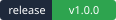
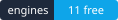
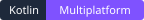

<div align="center">


[](https://github.com/mr-coder20/ioc-lens/releases/latest)
[](https://github.com/mr-coder20/ioc-lens/releases)
[](#threat-intelligence-engine-inventory)
[](.github/workflows/ci.yml)
[](LICENSE)
[](https://kotlinlang.org)
[](CONTRIBUTING.md)

### [Download from Releases](https://github.com/mr-coder20/ioc-lens/releases)

**Windows &nbsp;·&nbsp; macOS &nbsp;·&nbsp; Linux &nbsp;·&nbsp; Android &nbsp;·&nbsp; iOS**

<br>

[**English**](#english) &nbsp;·&nbsp; [**فارسی**](#persian) &nbsp;·&nbsp; [**Русский**](#russian)

</div>

---

<a id="english"></a>

# English

<div align="center">

[English](#english) · [فارسی](#persian) · [Русский](#russian)

**Copy / Drop** &nbsp;→&nbsp; **Privacy Guard** &nbsp;→&nbsp; **Threat-Intel Engines** &nbsp;→&nbsp; **One Clear Verdict**

</div>

**IOC Lens** is a lightweight, privacy-first cross-platform tool for SOC analysts and defenders. Paste, share, drag-and-drop, or QR-scan an IP address, domain, URL, or file hash, and get one clear, explainable verdict from multiple threat-intelligence sources at once without juggling browser tabs.

## Why IOC Lens

Checking a suspicious indicator usually means copying it, opening several websites, pasting it again and again, and comparing different answers by hand. IOC Lens does all of that in one step.

| Without IOC Lens | With IOC Lens |
|---|---|
| Several tabs, several logins | One quick lookup |
| Different answers to compare by hand | One combined, explainable verdict |
| Risk of pasting internal data into outside sites | Internal indicators stay strictly on your device |
| Heavy platforms for a quick check | A small, fast app across desktop and mobile |

## Highlights

- **Instant Zero-Key Triage**: Query **11 free unauthenticated community engines** out of the box (URLhaus, MalwareBazaar, ThreatFox, RDAP, Cloudflare DoH, Shodan InternetDB, AlienVault OTX, RIPE Stat, crt.sh, Feodo Tracker, and ipwho.is) with **zero API keys required**.
- **15 Supported Threat-Intel Providers**: Combines the 11 zero-key engines with 4 optional API-key engines (VirusTotal, AbuseIPDB, Pulsedive, IPQualityScore) configurable in **Settings**.
- **Fault-Tolerant Parallel Aggregator**: Parallel queries dispatched under configurable per-provider timeouts, 2 MB bounded HTTP response reads, circuit-breaker cooldowns, and Feodo blocklist TTL caching.
- **Memory-Safe Stream Hashing**: Files are hashed locally via 64 KB chunked streams on background I/O threads without uploading binaries or loading entire files into RAM.
- **Vision & Quishing Triage**: Scan or decode QR codes/barcodes with defanged preview, homograph/open-redirect inspection, and instant IOC triage.
- **Privacy Guard & Custom Rules**: Validates built-in private IPv4/IPv6 ranges (RFC 1918, CGNAT, loopback, link-local, ULA, NAT64, 6to4, octal/hex/DWORD forms) and internal TLDs (`.local`, `.lan`, `.internal`, `.corp`, `.home`, `.home.arpa`, `.localhost`, `.onion`) plus user-defined domains and CIDRs.
- **Encrypted Local Storage**: API keys and scan history are encrypted at rest (Android Keystore AES-256-GCM, Desktop AES-256-GCM with owner-restricted key permissions, iOS Keychain).
- **Multi-Target & Open Source**: Built with Kotlin Multiplatform & Compose Multiplatform for **Windows, macOS, Linux, Android, and iOS** under the MIT license.

<a id="threat-intelligence-engine-inventory"></a>

## Threat Intelligence Engine Inventory

| # | Provider | Auth Mode | Supported Indicators | Purpose |
|---|---|---|---|---|
| 1 | **URLhaus (abuse.ch)** | Zero-Key Free | URLs, Domains | Active malware payload distribution URLs & hosts |
| 2 | **MalwareBazaar (abuse.ch)** | Zero-Key Free | Hashes (MD5, SHA-1, SHA-256) | Confirmed malware binary repository lookup |
| 3 | **ThreatFox (abuse.ch)** | Zero-Key Free | IPs, Domains, URLs, Hashes | Corroborated botnet C2 and malicious IOCs |
| 4 | **RDAP / Registry** | Zero-Key Free | IPs, Domains | ICANN, ARIN, RIPE, APNIC allocation metadata |
| 5 | **Cloudflare DoH** | Zero-Key Free | Domains | Real-time encrypted DNS status validation |
| 6 | **Shodan InternetDB** | Zero-Key Free | IPs | Open ports, hostnames, and passive CVE banners |
| 7 | **AlienVault OTX** | Zero-Key (Optional Key) | Hashes, IPs, Domains, URLs | Open threat pulses and adversary campaigns |
| 8 | **RIPE Stat** | Zero-Key Free | IPs | BGP routing prefix and ASN telemetry |
| 9 | **crt.sh** | Zero-Key Free | Domains | Certificate Transparency log counts |
| 10 | **Feodo Tracker (abuse.ch)** | Zero-Key Free | IPs | Active botnet C2 blocklist telemetry |
| 11 | **ipwho.is** | Zero-Key Free | IPs | Proxy, VPN, Tor exit-node & ISP metadata |
| 12 | **VirusTotal** | Optional API Key | Hashes, IPs, Domains, URLs | Multivendor threat scanning across 70+ engines |
| 13 | **AbuseIPDB** | Optional API Key | IPv4, IPv6 | Community reports and abuse confidence score |
| 14 | **Pulsedive** | Optional API Key | IPs, Domains, URLs, Hashes | Risk level scoring and threat context |
| 15 | **IPQualityScore** | Optional API Key | IPv4, IPv6 | Fraud scoring and VPN/Proxy detection |

## Install

1. Open the **[Releases page](https://github.com/mr-coder20/ioc-lens/releases)**.
2. Under **Assets** of the latest release, download the package for your system:

   | System | File |
   |---|---|
   | Windows | `IOC-Lens-windows-x64.msi` |
   | macOS | `IOC-Lens-macos-arm64.dmg` |
   | Linux | `IOC-Lens-linux-amd64.deb` |
   | Android | `IOC-Lens-android.apk` |
   | iOS | Build from `iosApp/` via Xcode or TestFlight (when published) |

> **Recommended:** verify the SHA-256 digest of your download against `SHA256SUMS.txt` from the same release.

## Get Started

1. **Zero-Key Out-of-the-Box**: Launch IOC Lens and immediately paste an indicator, scan a QR code, or drop/select files for local SHA-256 hashing.
2. **Optional API Keys & Custom Rules**: Open **Settings** to configure optional API keys, custom internal domain/CIDR Privacy Guard rules, per-engine toggles, timeout, and Dark/Classic/Light/System themes.
3. **Android Share Target**: Share text, URLs, or files via **Share → IOC Lens** from browsers, messaging apps, or file managers.
4. **Desktop CLI & Drag-and-Drop**: Drag files or text directly into the window, or pass an indicator or local file path on launch (e.g. `io.github.mrcoder20.ioclens "8.8.8.8"` or `io.github.mrcoder20.ioclens sample.bin`).

## Building & Automated Testing

```bash
# Run shared JVM unit & security tests
./gradlew :shared:jvmTest

# Run desktop module tests
./gradlew :desktopApp:test

# Run Android host unit tests and Android lint
./gradlew :shared:testAndroidHostTest :androidApp:lintDebug

# Compile desktop and Android debug targets
./gradlew :desktopApp:compileKotlin :androidApp:assembleDebug
```

## Understanding Verdicts

| Verdict | Meaning |
|---|---|
| **Clean** | Explicitly checked with no malicious flags |
| **Low risk** | Weak or informational flags; review in context |
| **Suspicious** | Notable detections; worth investigating |
| **Malicious** | Strong, corroborated detections |
| **No data** | Unknown to active sources or network unavailable — **never treated as safe** |

## Privacy & Security

- **Privacy Guard** blocks private and internal indicators (plus your custom CIDRs and domain rules) before any network request is dispatched.
- Only the sanitized indicator is sent directly over HTTPS to enabled engines.
- **No backend, no account, no telemetry.**
- Secrets and history are encrypted locally on disk / in OS Keystore/Keychain.
- Found a vulnerability? Read [SECURITY.md](SECURITY.md).

<div align="right"><a href="#english">↑ Back to top</a></div>

---

<a id="persian"></a>

# فارسی

<div dir="rtl">

<div align="center">

[English](#english) · [فارسی](#persian) · [Русский](#russian)

**کپی / کشیدن و رها کردن** &nbsp;←&nbsp; **Privacy Guard** &nbsp;←&nbsp; **موتورهای هوش تهدید** &nbsp;←&nbsp; **یک حکم روشن و قابل‌توضیح**

</div>

**IOC Lens** یک ابزار چندسکویی سبک و حریم‌خصوصی‌محور برای تحلیلگران SOC و مدافعان امنیتی است. آدرس IP، دامنه، URL، هش یا فایل را کپی، اشتراک‌گذاری، رها یا اسکن QR کنید و هم‌زمان از چندین منبع هوش تهدید یک حکم شفاف و قابل‌استناد بگیرید.

## ویژگی‌های کلیدی

- **تریاژ فوری بدون نیاز به کلید API**: اتصال مستقیم به **۱۱ موتور رایگان بدون کلید** (URLhaus، MalwareBazaar، ThreatFox، RDAP، Cloudflare DoH، Shodan InternetDB، AlienVault OTX، RIPE Stat، crt.sh، Feodo Tracker و ipwho.is).
- **پشتیبانی اختیاری از ۴ موتور با کلید API**: امکان ثبت کلیدهای VirusTotal، AbuseIPDB، Pulsedive و IPQualityScore در بخش تنظیمات.
- **محاسبه امن و جریانی هش فایل (SHA-256)**: هش فایل‌ها بدون آپلود باینری و با بافر جریانی ۶۴ کیلوبایتی به‌صورت کاملاً محلی محاسبه می‌شود.
- **سپر حریم خصوصی (Privacy Guard) و قوانین سفارشی**: مسدودسازی خودکار IPهای داخلی (RFC 1918، CGNAT، loopback، link-local، IPv6 ULA/NAT64/6to4، فرم‌های هشت‌تایی/هگز) و دامنه‌های داخلی (`.local`، `.lan`، `.internal`، `.corp`، `.home`، `.home.arpa`، `.localhost`، `.onion`) به همراه امکان افزودن دامنه و CIDR دلخواه کاربر.
- **ذخیره‌سازی رمزنگاری‌شده محلی**: نگهداری کلیدهای API و تاریخچه با رمزنگاری AES-256-GCM / Android Keystore / iOS Keychain و بدون هیچ سرور میانی یا تله‌متری.
- **پشتیبانی کامل از سه زبان فارسی (RTL)، انگلیسی و روسی** و دو تم تاریک و روشن استاندارد.

## درک حکم‌ها

| حکم | معنی |
|---|---|
| **پاک (Clean)** | بررسی‌شده و بدون نشانه مخرب |
| **ریسک پایین** | سیگنال ضعیف یا اطلاعاتی؛ نیازمند بررسی در بافت |
| **مشکوک** | تشخیص قابل‌توجه؛ نیازمند بررسی دقیق‌تر |
| **مخرب** | تشخیص قوی و تأییدشده توسط موتورهای امنیتی |
| **بدون داده (No data)** | ناشناخته برای منابع فعال یا خطای شبکه — **هرگز به معنای امن بودن نیست** |

## حریم خصوصی و امنیت

- **Privacy Guard** نشانگرهای خصوصی و قوانین سفارشی شما را پیش از هرگونه درخواست شبکه‌ای روی دستگاه مسدود می‌کند.
- تنها خود نشانگر و فقط به موتورهای فعال‌شده از طریق HTTPS ارسال می‌شود.
- **بدون بک‌اند، بدون حساب کاربری و بدون تله‌متری.**
- برای گزارش آسیب‌پذیری‌ها فایل [SECURITY.md](SECURITY.md) را ببینید.

<div align="left"><a href="#persian">↑ بازگشت به بالا</a></div>

</div>

---

<a id="russian"></a>

# Русский

<div align="center">

[English](#english) · [فارسی](#persian) · [Русский](#russian)

**Копировать / Перетащить** &nbsp;→&nbsp; **Privacy Guard** &nbsp;→&nbsp; **Источники Threat Intel** &nbsp;→&nbsp; **Единый понятный вердикт**

</div>

**IOC Lens** — лёгкое кроссплатформенное приложение для аналитиков SOC и защитников с фокусом на приватность. Вставьте, отправьте, перетащите или отсканируйте через QR-камеру IP-адрес, домен, URL, хеш или файл и получите единый объяснимый вердикт из нескольких источников сразу.

## Ключевые возможности

- **Мгновенная проверка без API-ключей**: **11 бесплатных движков** работают сразу из коробки (URLhaus, MalwareBazaar, ThreatFox, RDAP, Cloudflare DoH, Shodan InternetDB, AlienVault OTX, RIPE Stat, crt.sh, Feodo Tracker, ipwho.is).
- **4 дополнительных движка с API-ключами**: опциональная настройка VirusTotal, AbuseIPDB, Pulsedive и IPQualityScore в настройках.
- **Потоковое хеширование файлов (SHA-256)**: локальный расчёт хешей буфером по 64 КБ без загрузки файлов на сторонние серверы.
- **Privacy Guard и пользовательские правила**: локальная блокировка внутренних IPv4/IPv6 (RFC 1918, CGNAT, loopback, link-local, ULA, NAT64, 6to4, восьмеричные/шестнадцатеричные формы), внутренних доменов (`.local`, `.lan`, `.internal`, `.corp`, `.home`, `.home.arpa`, `.localhost`, `.onion`) и собственных правил доменов/CIDR.
- **Локальное шифрование**: ключи и история хранятся локально в зашифрованном виде (Android Keystore AES-256-GCM, Desktop AES-256-GCM с правами только для владельца, iOS Keychain) без бэкенда и телеметрии.

## Как читать вердикты

| Вердикт | Значение |
|---|---|
| **Чисто** | Проверено, угроз не обнаружено |
| **Низкий риск** | Слабые или информационные сигналы |
| **Подозрительно** | Заметные срабатывания; требуется проверка |
| **Вредоносно** | Подтверждённое обнаружение угрозы |
| **Нет данных** | Неизвестно источникам или сбой сети — **не означает «безопасно»** |

---

<div align="center">

**Built for defenders · MIT License**

</div>
